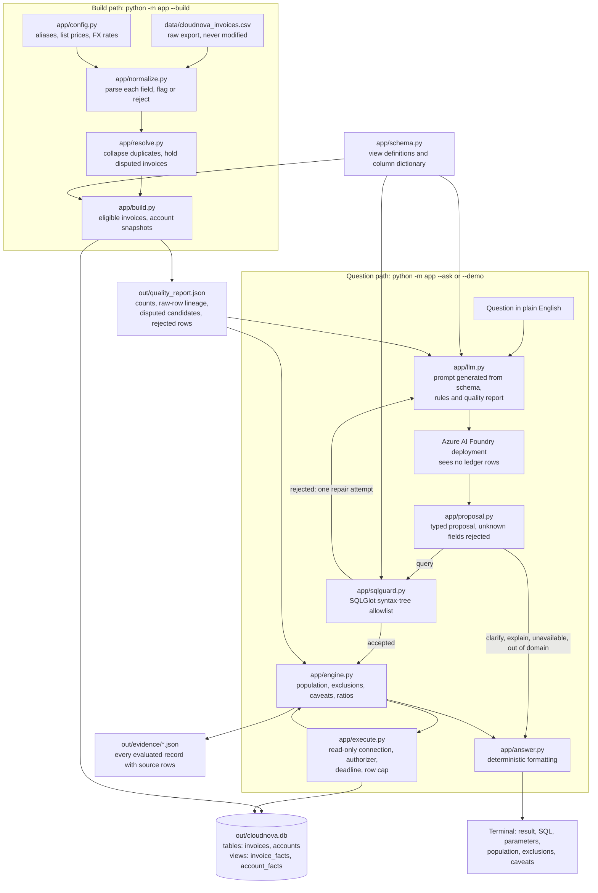

# Architecture

This diagram describes the code as built. Every box names the module or file that does the work.

## Build path

1. `app/build.py` reads the CSV as bytes, records its SHA-256 and numbers the data rows from 1.
2. `app/normalize.py` parses each field with the rules in `app/config.py`. A row with an invalid required field is kept as a candidate with its errors. Invalid optional fields become null with a flag.
3. `app/resolve.py` groups rows by invoice ID and applies the policy in spec section 3: exact duplicates collapse, normalized duplicates collapse, a single valid candidate wins, and several valid candidates leave the invoice disputed and out of the tables.
4. `app/build.py` writes the `invoices` and `accounts` tables and the two views into a temporary file and moves it into place when complete. It then writes the quality report.

The database holds only eligible invoices. Disputed candidates and rejected rows live in the quality report, with their source rows.

## Question path

1. `app/llm.py` builds the prompt from three sources: the column dictionary in `app/schema.py`, the constants in `app/config.py`, and the counts and date coverage in the quality report. The model receives no ledger rows, account names, IDs or email addresses.
2. The model replies with one JSON proposal. `app/proposal.py` checks its shape and rejects unknown fields.
3. A `query` proposal goes to `app/sqlguard.py`, which parses the SQL with SQLGlot and checks every node of the syntax tree against an allowlist: one `SELECT`, one approved view, known columns, approved functions, bound text values. It also refuses averages and divisions of money, sums of repeated account values, and mixed-currency sums.
4. If the proposal or its SQL is rejected, `app/llm.py` sends the reason back to the model once. The second reply gets the same validation. A second failure is an error.
5. `app/engine.py` runs the accepted query through `app/execute.py`. That connection is opened read-only, an authorizer permits only `SELECT` on the modeled data with approved functions, and a progress handler stops a query at its deadline.
6. `app/engine.py` then works out what the answer needs:
   - the evaluated population, by running the query's own `WHERE` clause without grouping or limits;
   - whether disputed invoices matter, by running that same `WHERE` clause over the disputed candidates in a private in-memory database with the same view definition;
   - the caveats, chosen from the view, the columns used and the filter;
   - ratios, divided with decimal arithmetic from the integer sums and counts the query returned.
7. `app/answer.py` formats the values and prints the answer. `app/engine.py` writes the evidence file.

`clarify`, `explain`, `unavailable` and `out_of_domain` proposals run no query. One more clarification comes from the application itself: if a query filters on an account name that belongs to several account IDs, the engine asks which ID is meant before running anything.

## Evaluation path

`python -m evals` uses the same modules:

- Fixture ledgers in `evals/fixtures/` go through the same build.
- Hand-written proposals go through `app/engine.py`, the same entry the model's proposals use.
- A stub transport stands in for the model to test repair and error handling. Its answers are labelled "stub transport (not a model response)".
- `python -m evals --live` sends real questions to the configured deployment.

## What is not in the diagram

There is no vector store, embedding step, agent framework, web service or cloud deployment. The spec excludes them for this scope: every stakeholder question needs arithmetic over a complete set of records, which retrieval of similar rows cannot establish.
