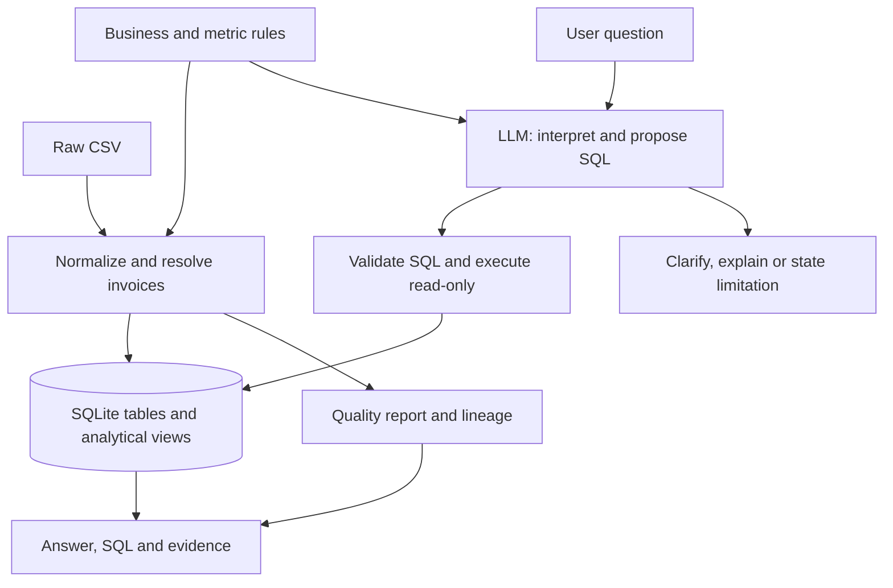

# CloudNova solution specification

**Draft v0.2 — November 10, 2026. Track B proposed for review.**

Revision: the six stakeholder questions are baseline evaluations, not the limit of the product. This draft replaces fixed question templates with general querying over documented data and business rules, plus explicit clarification and unsupported-request handling.

The CSV has been profiled and reference results calculated. The application and its evaluation harness have not been built. The decisions below are proposed assumptions, not confirmed customer policy.

## 1. Proposed approach

Build a local Python CLI that cleans the ledger, creates two SQLite tables with two documented analytical views, and answers natural-language questions supported by that data. An LLM interprets the question using the schema and business definitions, proposes SQL and bound parameters, and the application validates and executes the query. Responses include the result, executed query, source references, and relevant data-quality limitations.

The system must support previously unseen combinations of fields, filters, time periods, grouping, measures, and rankings. It must not route questions through an enum containing the six sample questions or select only their SQL templates. Business definitions are reusable constraints; the question list is an evaluation seed. No vector store, embeddings, agent framework, frontend, or cloud deployment is needed for this scope.

General querying means answering new questions when the data and supported query operations can establish the answer. Ambiguous questions receive a clarification. Missing-data, unsupported-operation, causal, and unrelated questions receive an accurate explanation instead of a fabricated answer. It is not a promise to answer every conceivable question.

**Why:** all six questions need complete-set arithmetic. Retrieval alone cannot establish a financial total. The difficult work is deciding which records and business definitions are eligible for that arithmetic.

**Main trade-off for review:** calculate transparent subtotals when invoices conflict, and label account metrics as estimates. Do not imply that cleaning can recover missing source authority or a reliable subscription history.

## 2. What the supplied file actually contains

Source: `cloudnova_invoices (1).csv`, 19 columns. Counts below are observations from this exact file unless explicitly labeled proposed.

| Finding | Observed result | Design consequence |
| --- | --- | --- |
| Input size | 5,125 rows; 5,000 distinct invoice IDs; 3,815 distinct account IDs | Deduplicate invoices before aggregation. |
| Literal duplicates | 82 excess identical rows | Collapse without losing source references. |
| Remaining duplicate IDs | 43 IDs have two distinct raw records after exact deduplication | Normalize before deciding whether records actually disagree. |
| Semantic duplicates | 27 of those 43 pairs become equivalent after normalization | Cosmetic status differences are not financial conflicts. |
| Actual invoice conflicts | 16 IDs still disagree on status; none disagree on amount in this file | Use the conflict policy below. |
| Invalid status/sign combinations | Two negative amounts are labeled paid in one candidate and refunded in another | The refunded candidate satisfies the supplied sign rule. |
| Repeated account IDs | 980 IDs have multiple distinct invoices; 976 have different account names | Account identity/state cannot be treated as verified. |
| Account attribute disagreement | 774 IDs vary in region; 334 vary in normalized churn flag | Latest-invoice state is an explicit approximation. |
| Ambiguous hyphen dates | 82 invoice rows representing 81 invoice IDs; 125 signup rows | Apply and disclose the format convention below. |
| Date coverage | Invoice dates span 2021-01-19 through 2027-07-23 under that convention | Default to the export's available data, not the machine's current date. |
| Optional blanks | Email 292; industry 422; CSAT 623; payment method 637 raw rows | Keep missing values unknown; do not discard otherwise usable revenue. |
| Malformed nonblank email | 142 raw rows under a basic syntax check | Flag; do not infer a corrected address. |

There is also an apparent pricing/FX inconsistency. For example, `INV-103521` has 10 Starter seats, monthly billing, no discount, and EUR 529.20. The pricing formula gives USD 490, while the stated EUR-to-USD conversion gives USD 571.54 after rounding. The recorded EUR amount instead equals 490 × 1.08. Similar behavior appears across the foreign-currency non-refund records inspected.

This suggests a source-generation or briefing inconsistency; its cause is not established. **Follow the briefing's conversion direction, retain actual recorded amounts, and report the discrepancy.** Do not silently divide by the FX rate or reconstruct revenue from list prices.

## 3. Cleaning and conflict contract

Preserve the original CSV. Assign `source_row` starting at 1 for the first data record, and record the file SHA-256. Normalize into new outputs only.

### Category mappings

Trim surrounding whitespace and compare case-insensitively.

| Field | Accepted aliases → canonical value |
| --- | --- |
| Plan | starter, start, tier 1 → `starter`; pro, professional, tier 2 → `pro`; enterprise, ent, tier 3 → `enterprise` |
| Status | paid, complete, completed, success → `paid`; pending, in_review, awaiting → `pending`; failed, declined, error → `failed`; refunded, refund, charged_back → `refunded`; void, cancelled, canceled → `void` |
| Billing cycle | monthly → `monthly`; annual, annually, yearly → `annual` |
| Churn | true, yes, 1, y → true; false, no, 0, n → false |
| Payment method | credit card, credit_card → `credit_card`; ach → `ACH`; wire, wire transfer → `wire`; invoice → `invoice`; blank → null |

Unknown required categories are invalid, not silently mapped to a default. Unknown optional payment methods become null with a flag. Normalize currency and region to uppercase and validate against the supplied enumerations.

### Types, money, dates, and nulls

- Parse amounts from their string representation with decimal arithmetic. Accept recognized currency markers, grouping commas, whitespace, a minus sign, and an optional decimal fraction. `31432` means 31,432.00 currency units; do not invent missing cents. Reject unrecognized tokens, invalid grouping, and nonfinite values. An explicit conflicting currency marker is an error; the `currency` column supplies the conversion currency.
- Use USD 1, EUR 1.08, GBP 1.27. Round each converted invoice to USD cents using `ROUND_HALF_UP`, then sum integer cents. Apply the same cent rounding to derived per-account MRR. Calculate averages and percentages from integer sums/counts and round only for display. This rounding convention is an explicit assumption.
- Seats must be a positive integer. Discount must be between 0 and 100 percent, with at most two decimal places. Store discount as integer basis points. CSAT is nullable, otherwise an integer from 1 to 5. Support tickets are a nonnegative integer; invalid optional values become null with a flag.
- Parse `YYYY-MM-DD` and `YYYY/MM/DD` as year-month-day; `MM/DD/YYYY` as US month/day; English `Jan 5 2024` style dates by month name; `DD-MM-YYYY` as day/month. Flag hyphen dates where both interpretations are valid and differ. Do not use automatic locale inference.
- An unparseable invoice date makes the candidate ineligible. An invalid signup date is nullable with a flag. A date before signup is flagged for review, not silently changed. Future-looking sample dates are retained and disclosed.
- Keep absent industry/CSAT/email as null. Preserve original emails in the raw input; malformed cleaned emails become null with a flag. Do not interpret missing CSAT as satisfied or dissatisfied.

### Which duplicate wins

1. Collapse exact raw duplicates, retaining every source-row reference.
2. Normalize the remaining candidates. Collapse records identical across all canonical source fields; the smallest source row is the representative for provenance only.
3. Validate candidates. A refunded amount must be negative; other statuses must have nonnegative amounts. If exactly one distinct candidate satisfies all required validation rules, it wins.
4. If multiple distinct valid candidates remain, **no candidate is eligible**. Put the entire invoice ID in the conflict report and exclude it from modeled totals. Do not prefer paid, void, or CSV order as evidence of truth.

For this file the proposed policy yields:

| Disposition | Count |
| --- | ---: |
| Exact plus normalized duplicate excess removed | 109 rows |
| Invalid negative-paid alternatives rejected | 2 rows |
| Unresolved candidates held for review | 28 rows across 14 invoice IDs |
| Eligible canonical invoices | 4,986 |
| Accounts with at least one eligible invoice | 3,803 |

Reconciliation: **5,125 = 109 + 2 + 28 + 4,986**. Twelve account IDs have only unresolved invoices and therefore do not enter the account snapshot. Two other affected accounts retain eligible invoices. Every exclusion must remain traceable.

This policy deliberately produces scoped subtotals where conflicts affect the question. Selecting a winner for the remaining conflicts requires source priority or an authoritative status update, neither of which is provided.

## 4. Modeled data

Two physical tables and two analytical views are sufficient. The raw CSV plus a lineage/quality report preserve the rejected and duplicate candidates.

| Table | Grain and fields |
| --- | --- |
| `invoices` | One eligible row per `invoice_id` (TEXT primary key). TEXT `account_id`, account name, region, nullable industry/email/payment method; canonical plan/status/cycle/currency; INTEGER seats, discount basis points, local amount cents, USD amount cents, churn 0/1, nullable CSAT/tickets; ISO TEXT invoice/signup dates; source row and quality flags. |
| `accounts` | One row per `account_id` (TEXT primary key). Selected invoice ID/date; name, region, industry, signup date, plan, billing cycle, seats, discount, churn, CSAT, support tickets; INTEGER MRR cents; account fields that disagree across invoice history. Selected invoice references `invoices`. |

Expose these views to the question interface, with a column dictionary specifying type, unit, null behavior, row grain, and time meaning:

| View | Purpose and reusable measures |
| --- | --- |
| `invoice_facts` | One row per eligible invoice, retaining its invoice-level dimensions and dates. Add integer-cent measures: `paid_revenue_cents` (paid amount, otherwise zero), `net_revenue_cents` (paid/refunded amount, otherwise zero), `refunds_cents` (positive refunded value, otherwise zero), and `exposure_cents` (pending/failed amount, otherwise zero). These definitions are code-owned. |
| `account_facts` | One row per eligible account snapshot, retaining its selected attributes, MRR, churn flag, CSAT and support tickets. Join internally to invoice totals already aggregated to one row per account: lifetime paid/net revenue, refunds, exposure, and invoice count. Explicitly label these totals as all available dates. |

The account view's internal join is written and tested by application developers. Do not expose an unrestricted model-generated invoice/account join that could multiply MRR or churn denominators. Invoice-level region/plan/industry and selected account attributes have different time meanings; the schema and answer must distinguish them. Never sum repeated account-level support-ticket or CSAT values across invoices. Preserving these fields supports new questions without inventing additional data.

The quality report records input hash, rules version, counts, all original source rows per canonical invoice, exclusions with reasons, date assumptions, and account disagreements. Rebuilding the same input with the same configuration must reproduce the same business outputs.

**Account snapshot rule:** choose the eligible invoice with the greatest parsed invoice date; break ties by greatest invoice ID lexicographically. Copy its account attributes together. Do not combine fields from unrelated dates. Payment status does not independently establish subscription activity: use that row's normalized churn flag as the activity proxy.

Compute account MRR as `price × seats × (1 − discount/100)` when churn is false, otherwise zero. Prices are USD 49/99/299 for Starter/Pro/Enterprise. Annual billing does not change this formula. Account metrics are labeled **latest-invoice estimates**, not current verified subscription metrics. The account ID remains the grouping key specified by the briefing; do not split or merge customers using names or email addresses.

The latest available invoice date is a coverage label, not a proven export timestamp. Do not offer historical account snapshots or monthly churn rates from this model.

## 5. Metric definitions and reference results

Reference results below were calculated during exploration under this exact draft's rules. They are regression targets, not independently verified customer truth or evidence that an application already passes evaluations. Changes to deduplication, FX, date, rounding, or snapshot policy require rebaselining.

| Stakeholder question | Query definition | Reference result |
| --- | --- | --- |
| Paid revenue in 2024 | Sum eligible paid USD cents where invoice date is in `[2024-01-01, 2025-01-01)`. Do not subtract refunds from an explicitly paid-only question. | **USD 32,655,352.52**, 888 invoices; 3 disputed 2024 IDs excluded. |
| Region with highest average MRR | Group eligible, non-churned account snapshots by their selected region; sum MRR / count accounts. Each account has equal weight. | **APAC: USD 6,164.03 per active account**, 752 accounts. Estimate. |
| Refunds given back | Negate the sum of eligible refunded USD cents, presented as a positive amount. Default is all available invoice dates. | **USD 8,925,163.84**, 292 invoices. |
| Enterprise vs Starter churn | Within each selected plan, churned account count / all eligible account snapshots in that plan. Include both churned and non-churned accounts in the denominator. | Enterprise **170/778 = 21.85%**; Starter **353/1,879 = 18.79%**. Observed proportions, not period churn rates. |
| Top five accounts by revenue | Default revenue means paid plus negative refunded amounts. Aggregate by account ID before joining the one-row account snapshot. Sort net revenue descending, account ID ascending for ties. | See table below. Rankings use eligible invoices. |
| Pending/failed exposure | Count eligible invoices with either status and sum their positive USD amounts. Default is all available dates. | **894 invoices; USD 28,983,255.97**. Partial where disputed statuses could change inclusion. |

The three disputed 2024 invoices are `INV-103437`, `INV-103655`, and `INV-101678`. Their possible additional paid contribution totals **USD 31,018.68** under the stated FX/rounding rules. The first answer must say “eligible paid subtotal,” not claim an exact complete ledger total.

| Account ID | Eligible net revenue, USD | Selected CSAT | Low-CSAT flag |
| --- | ---: | ---: | --- |
| ACC-7509 | 1,210,592.75 | 4 | No |
| ACC-1420 | 1,208,092.75 | Unknown | Unknown |
| ACC-9946 | 1,205,642.75 | 4 | No |
| ACC-1196 | 1,107,352.84 | 3 | No |
| ACC-5211 | 1,085,078.48 | 5 | No |

For general “recognized revenue” without a paid-only restriction, default to paid plus negative refunds and state that definition. Never subtract a negative refund twice. Date-filter revenue by invoice issue date because payment dates are absent. This is the exercise's ledger definition, not a deferred-revenue accounting model. “Stuck” pending/failed means status exposure; days overdue cannot be established without due dates.

## 6. Question interface and execution

Proposed commands after dependency setup and API-key configuration:

```bash
python -m app --demo
python -m app --ask "What was our paid revenue in 2024?"
python -m evals
python -m evals --live
```

`--demo` builds the local database from the configured CSV and runs the six stakeholder questions through the actual model adapter. The offline eval command checks transformations and deterministic query execution; `--live` additionally evaluates real question interpretation. Neither mode may disguise stored answers as a live model response.

### Question handling

The model sees the two view schemas, business definitions, available date coverage, data-quality summary, and output contract. The briefing fits directly into context; retrieving embeddings is unnecessary. Do not send the raw CSV or billing email values to the model.

| Request class | Required behavior | Example beyond the original list |
| --- | --- | --- |
| New, answerable data question | Generate and validate a query; return evidence and applicable caveats. | “Show monthly net revenue for EMEA in 2024, split by plan.” |
| New account comparison | Query the account view at account grain and label snapshot estimates. | “Compare average MRR by industry for non-churned Pro accounts.” |
| Record lookup or filtering | Query matching records; preserve IDs and disclose result limits. | “List annual invoices over USD 10,000 with discounts of at least 15%.” |
| Business-rule explanation | Explain from the supplied briefing/spec and identify that source; no invented numeric result. | “Why is annual MRR not the annual invoice divided by 12?” |
| Ambiguous intent or entity | Ask one targeted clarification before querying. The next CLI prompt may supply the answer. | “Who are our best customers?” → best by revenue, MRR, or another measure? |
| Missing evidence | Name the missing data and, when useful, describe a supported alternative without presenting it as the requested answer. | “What caused churn?” lacks cancellation reasons; “What is gross margin?” lacks costs. |
| Unsupported query operation | Explain the implementation limit separately from missing data. | A novel cross-grain query requiring an unapproved join may be answerable in principle but unsupported in v1. |
| Unrelated request | State that the tool answers CloudNova invoice/account questions. Do not execute a query or fall back to unrelated model knowledge. | “What is tomorrow's weather?” |

For a query, return a typed proposal containing `action`, `sql`, `parameters`, `source_view`, `interpretation`, and output units. For other actions, return `clarify`, `explain`, `unavailable`, or `out_of_domain` with the relevant question/reason/source. These actions describe behavior, not a fixed inventory of business questions. Reject malformed proposals; do not silently drop requested filters.

Example of an unseen question translated into a new query:

```json
{
  "action": "query",
  "source_view": "invoice_facts",
  "interpretation": "Monthly eligible net revenue by invoice plan for EMEA in 2024",
  "sql": "SELECT strftime('%Y-%m', invoice_date) AS month, plan, SUM(net_revenue_cents) AS net_revenue_cents FROM invoice_facts WHERE region = :region AND invoice_date >= :start AND invoice_date < :end GROUP BY month, plan ORDER BY month, plan",
  "parameters": {"region":"EMEA","start":"2024-01-01","end":"2025-01-01"},
  "output_units": {"net_revenue_cents":"USD cents"}
}
```

### Supported query operations and safeguards

The initial grammar supports one SELECT over one approved view, with column selection, bound-value filters, AND/OR, comparisons, IN, null tests, CASE, GROUP BY, HAVING, ORDER BY, LIMIT, COUNT/DISTINCT, SUM, AVG, MIN/MAX, and approved scalar functions such as date bucketing. This supports new breakdowns, trends, comparisons, lists and rankings without adding a question handler. Period comparisons can use conditional aggregation. The first version excludes model-generated joins, subqueries, CTEs, window functions and arbitrary functions. These limits must be reported honestly, not mistaken for missing underlying data.

Parse the whole proposal with a SQLite-aware SQL parser such as SQLGlot and inspect its syntax tree, including all expressions. Require exactly one statement, only approved views/columns/functions, and the supported grammar. Reject writes, DDL, ATTACH/DETACH, PRAGMA, extension loading and catalog access. Checking whether text begins with SELECT is insufficient. Bind filter values separately; validate identifiers against the schema.

Execute through a read-only database connection with an authorizer policy, no extension loading, and a query execution deadline. Cap displayed detail rows (default 200) and state any truncation. Never apply that cap to the input population before computing an aggregate. Permit at most one repair attempt for a syntax/schema error, with the same validation; otherwise return an error. This guarded execution layer is the production-hardening feature.

Business arithmetic remains defined in the views. For monetary averages and percentages, request integer sums/counts and finish division/rounding with decimal arithmetic. The model must not redefine MRR, revenue eligibility, FX, or the account denominator. Validate the requested measure, row grain, units, and filter compatibility against the metric contract where mechanically checkable. Syntax validation and read-only access do not prove that the model interpreted the question correctly; unseen-question evaluations are essential.

### Answer and evidence contract

Return the interpreted scope, result/table, actual executed SQL and parameters, units, evaluated population count, applicable exclusions, and limitations. Format numbers from query results deterministically. Answers about customer behavior cannot claim causation from descriptive invoice data.

Record the input hash/rules version and preserve raw-row lineage. Provide a few readable record references and an evidence export for the evaluated input population. For rankings or HAVING filters, distinguish the full population evaluated from records belonging to returned groups. Derive evidence from the validated query's source/filter rather than a separately invented model query. If exact group attribution is unavailable, state that evidence covers the evaluated population instead of claiming exact per-result lineage.

Warnings follow the views/columns and period used, not the original six question labels. Invoice conflicts affect relevant totals; account disagreements affect account estimates; date ambiguity affects periods/snapshot choices; FX discrepancies affect foreign-currency money. Evaluate excluded candidates against query filters where possible. If their relevance cannot be determined, report it as unknown rather than zero exclusions. Empty populations return no data; zero-denominator ratios are unavailable.

Missing keys, provider failures, or invalid proposals return clear errors. A question being absent from the sample list is never itself a reason to reject it. Configure paths, provider/model, business rules, query limits and timeout; commit `.env.example` but no secrets. Use one provider adapter in v1.

## 7. Proposed architecture



This diagram describes the proposed build. The committed submission diagram must be updated if implementation differs.

## 8. Evaluation contract

Use small hand-calculated fixtures to verify business rules independently, then the uploaded file's reference results to catch regression. Do not generate the expected values by invoking the implementation under test.

| Case | Required outcome |
| --- | --- |
| Paid vs net | Paid USD 100, refund −20, pending 50: paid revenue 100; net revenue 80; refunds given back 20; exposure 50. |
| FX and parsing | `1,200.00 EUR` → USD 1,296.00; GBP 100 → USD 127.00; `31432` → local 31,432.00. |
| Annual MRR and account grain | Two annual invoices for one active account with 10 Starter seats and no discount: MRR 490 once, not 980 and not 4,900/12. |
| Dates | `01/05/2024` → January 5; `05-01-2024` → January 5 with ambiguity flag. Test both year boundaries. |
| Duplicate handling | Exact and alias-only repeats collapse; negative paid/refunded pair selects refunded; positive paid/pending conflict is excluded and reported. |
| Account churn and missing CSAT | Repeated invoices do not increase the account denominator. CSAT 2 is flagged; null remains unknown. |
| Six supplied questions | Match the reference results above, relevant SQL filters, evidence IDs, and partial/estimate warnings. Test at least one paraphrase per question in live mode. |
| Unseen invoice breakdown | Monthly net revenue by region/plan and arbitrary date range: match independently calculated grouped totals and query filters. |
| Unseen account analysis | Active Pro average MRR by industry and a threshold filter on selected support tickets: match account-grain reference results; never count invoices as accounts. |
| Unseen record lookup | Annual invoices above a USD threshold with a discount filter: return exactly matching IDs and show truncation only when relevant. |
| Ambiguous request | “Best customers” asks for the ranking measure. An account name mapping to multiple IDs asks for the intended ID instead of silently merging them. |
| Missing data and unrelated requests | Gross margin identifies missing costs; causal churn reasons identify missing evidence; weather returns out of domain. No invented SQL columns or numbers. |
| Expected capability failure | “What was Enterprise monthly churn in March 2024?” → unsupported because churn-event dates and historical subscription populations are absent. Report as documented XFAIL; returning a fabricated rate is an unexpected failure. |
| Query boundary | Reject hidden writes, multiple statements, unapproved views/functions, joins and injection attempts; enforce timeout and detail limits without truncating aggregate inputs. No mutation occurs. |

Compare money in cents exactly, counts/IDs exactly, and displayed percentages/averages to two decimals using the declared rounding rule. The harness prints PASS/FAIL/XFAIL plus the reason and exits nonzero for unexpected failures. Missing API credentials skip live tests explicitly; a skip is not a pass.

Acceptance requires the six baseline questions plus at least three materially new answerable questions and the ambiguity/missing-data cases. Select additional held-out questions after implementation, without adding a handler for each question. Paraphrases alone are not a generalization test. Run live evaluations through question interpretation, validation, execution and response formatting; test data logic separately offline. Document observed failures rather than claiming universal coverage.

## 9. Delivery scope and build order

Use Python's CSV/decimal/SQLite modules, one model SDK, and a SQL parser for validation. Pin the versions actually tested. The SQLite module must be available in the chosen Python environment. The wider interface adds validation and evaluation work; the single-view query grammar keeps the first implementation bounded.

| Approximate active-work allocation | Deliverable |
| --- | --- |
| 0–15 minutes | Profile data, write/review spec and expected behavior, commit spec first. |
| 15–30 minutes | Implement normalization, conflict report, two tables and analytical views. |
| 30–45 minutes | Add schema-grounded SQL generation, validation, CLI, clarification and evidence output. |
| 45–55 minutes | Run fixtures, dataset regression, and live question cases; fix failures. |
| 55–60 minutes | Finish README, accurate architecture diagram, limitations, and actual prompt log. Stop and document unfinished work. |

These are proposed allocations, not a claim that this work has already been completed within an hour. Include profiling/spec work in the actual time record.

Required repository artifacts: `README.md`; `specs/solution.md`; `AGENTS.md` or the chosen tool's equivalent; `docs/prompts.md` containing genuine prompts/corrections; `docs/architecture.md`; application modules; `evals/` fixtures/cases/runner; dependency setup; `.env.example`; `.gitignore`.

The AI instructions must require reading the spec before changes, preserving raw input, keeping metric logic in code/SQL, supporting unseen questions through the schema, reporting limitations accurately, and never rewriting expected outputs simply to make tests pass. Do not implement a switch over the six stakeholder questions or hardcode their answers. Record real steering decisions, including replacing the original fixed-template design, retaining the stated FX direction and rejecting unsupported duplicate precedence. Use small honest commits; do not reconstruct a fictional build history. If the timebox ends before guardrails or novel-question checks pass, document the unfinished capability and do not present it as proven robust.

**With another day:** resolve account identity and FX discrepancies with finance, obtain source/update precedence for the 14 disputed invoices, add a real subscription/churn-event source, and extend SQL operations and cross-grain analysis with corresponding semantic checks and held-out evaluations.

## Source and implementation references

- User-provided take-home assignment and Business Context & Data Dictionary in this conversation.
- Uploaded `cloudnova_invoices (1).csv`; SHA-256 `f542bc1f8193ab367e0a009a7afe56620335ce23b5817f5edc0ed4f896c89d84`. Counts and reference amounts above were calculated from this file under the stated draft rules.
- [Python SQLite documentation](https://docs.python.org/3/library/sqlite3.html): local database access, parameter binding, and connection configuration.
- [Python decimal documentation](https://docs.python.org/3/library/decimal.html): decimal parsing and explicit rounding.
- [SQLGlot documentation](https://sqlglot.com/sqlglot.html): parsing SQL, traversing syntax trees, and checking referenced expressions. The parser is a validation component, not a complete security or semantic-correctness guarantee.
